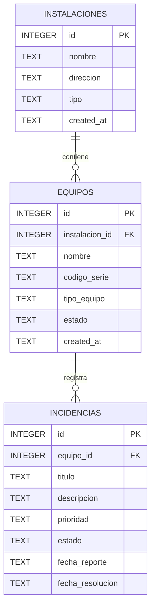

# Plan de Proyecto: Sistema de Gestión de Instalaciones, Equipos e Incidencias (Contratia Mini)

## 1. Descripción del Proyecto
La aplicación es una solución web ligera diseñada para registrar y centralizar la información de **instalaciones** (edificios públicos, naves industriales, centros comunitarios), identificar y catalogar sus **equipos técnicos** (ascensores, sistemas de climatización, calderas, generadores) y gestionar de manera ágil las **averías o incidencias** surgidas en ellos.

**Ejemplo de caso de uso:**
> En un edificio público (Instalación: "Biblioteca Central"), se reporta que el ascensor principal (Equipo: "Ascensor A1 - Bloque Norte") se ha detenido entre plantas (Incidencia: "Fallo en motor de tracción / puertas bloqueadas - Prioridad Alta"). El equipo técnico puede registrar la incidencia, actualizar su estado a "En progreso" y registrar su resolución.

---

## 2. Tecnologías Seleccionadas

* **Backend / Entorno de Ejecución:** Node.js con Express.js.
* **Base de Datos:** SQLite (mediante driver síncrono/asíncrono de alto rendimiento como `better-sqlite3` o `sqlite3`), almacenamiento en archivo local sin necesidad de servidor de BD externo.
* **Frontend:** HTML5 semántico, CSS3 moderno (estilos limpios y responsivos) y JavaScript Vanilla (ES6+, Fetch API, manipulación nativa del DOM, sin frameworks como React, Vue o Angular).
* **Gestión de dependencias:** npm.

---

## 3. Arquitectura del Sistema

Se adopta una **Arquitectura Cliente-Servidor desacoplada** con backend orientado a **API RESTful** y frontend como **Single/Multi-View Application basada en JavaScript Vanilla**:

```mermaid
flowchart LR
    subgraph Frontend ["Frontend (Vanilla JS)"]
        UI["HTML5 / CSS3"]
        DOM["Controlador DOM (app.js)"]
        API_CLIENT["Servicio API (Fetch Client)"]
        UI --> DOM
        DOM --> API_CLIENT
    end

    subgraph Backend ["Servidor Express (Node.js)"]
        ROUTER["Router / Endpoints REST"]
        CONTROLLER["Controladores"]
        SERVICE["Lógica de Negocio"]
        DB_LAYER["Capa de Datos (SQLite)"]
        
        ROUTER --> CONTROLLER
        CONTROLLER --> SERVICE
        SERVICE --> DB_LAYER
    end

    subgraph Database ["Almacenamiento"]
        SQLITE[("contratia.sqlite")]
        DB_LAYER --> SQLITE
    end

    API_CLIENT <-->|Peticiones HTTP / JSON| ROUTER
```

### Justificación de la Arquitectura:
1. **Separación de responsabilidades:** La API REST expone recursos independientes en formato JSON (`/api/instalaciones`, `/api/equipos`, `/api/incidencias`), permitiendo modularidad y claridad.
2. **Ligereza y simplicidad:** Express sirve los ficheros estáticos de la carpeta `public/` y procesa las peticiones REST. No requiere bundlers complejos (Webpack, Vite) ni procesos de compilación frontend para ejecutarse.
3. **Mantenibilidad en Vanilla JS:** Se organiza el código cliente en módulos limpios de JS nativo (gestión de estado local básica, capa de comunicación con Fetch y renderizado dinámico del DOM).

---

## 4. Modelo de Datos (3 Tablas Relacionadas)

El modelo relacional implementa una jerarquía en cascada estricta de 3 entidades:

### Definición de Tablas DDL (SQLite)

1. **`instalaciones`**:
   * `id`: `INTEGER PRIMARY KEY AUTOINCREMENT`
   * `nombre`: `TEXT NOT NULL` (ej. "Edificio Administrativo Este")
   * `direccion`: `TEXT NOT NULL` (ej. "Av. de la Constitución 45")
   * `tipo`: `TEXT NOT NULL` (ej. "Educativo", "Sanitario", "Administrativo", "Comercial")
   * `created_at`: `DATETIME DEFAULT CURRENT_TIMESTAMP`

2. **`equipos`**:
   * `id`: `INTEGER PRIMARY KEY AUTOINCREMENT`
   * `instalacion_id`: `INTEGER NOT NULL`, Foreign Key referencia a `instalaciones(id)` `ON DELETE CASCADE`
   * `nombre`: `TEXT NOT NULL` (ej. "Ascensor de Servicio B")
   * `codigo_serie`: `TEXT UNIQUE NOT NULL` (ej. "ASC-2023-0091")
   * `tipo_equipo`: `TEXT NOT NULL` (ej. "Elevación", "Climatización", "Eléctrico", "PCI")
   * `estado`: `TEXT CHECK(estado IN ('OPERATIVO', 'AVERIADO', 'EN_MANTENIMIENTO')) DEFAULT 'OPERATIVO'`
   * `created_at`: `DATETIME DEFAULT CURRENT_TIMESTAMP`

3. **`incidencias`**:
   * `id`: `INTEGER PRIMARY KEY AUTOINCREMENT`
   * `equipo_id`: `INTEGER NOT NULL`, Foreign Key referencia a `equipos(id)` `ON DELETE CASCADE`
   * `titulo`: `TEXT NOT NULL` (ej. "Ruidos extraños en freno motor")
   * `descripcion`: `TEXT NOT NULL`
   * `prioridad`: `TEXT CHECK(prioridad IN ('BAJA', 'MEDIA', 'ALTA', 'CRITICA')) DEFAULT 'MEDIA'`
   * `estado`: `TEXT CHECK(estado IN ('ABIERTA', 'EN_PROGRESO', 'RESUELTA', 'CERRADA')) DEFAULT 'ABIERTA'`
   * `fecha_reporte`: `DATETIME DEFAULT CURRENT_TIMESTAMP`
   * `fecha_resolucion`: `DATETIME NULL`

---

## 5. Funcionalidades del Sistema

### 5.1 Gestión de Instalaciones
* Crear nueva instalación indicando nombre, dirección y tipo.
* Listar todas las instalaciones con indicador de número de equipos e incidencias activas.
* Consultar detalle de una instalación con el listado de sus equipos asociados.
* Modificar y eliminar instalaciones (con borrado en cascada o validación de dependencias).

### 5.2 Identificación y Control de Equipos
* Registrar equipos vinculados a una instalación específica con número de serie único.
* Listar y filtrar equipos por instalación, tipo y estado operativo.
* Editar datos del equipo o cambiar manualmente su estado operativo.
* Eliminación de equipos.

### 5.3 Gestión de Averías / Incidencias
* Registrar incidencia asociada a un equipo (cambiando automáticamente el estado del equipo a `AVERIADO` si la prioridad es alta o crítica).
* Filtrar incidencias por estado (`ABIERTA`, `EN_PROGRESO`, `RESUELTA`) y por prioridad.
* Cambiar el estado de la incidencia (al marcar como `RESUELTA` o `CERRADA`, registrar la fecha de resolución y restaurar el equipo a `OPERATIVO` si no tiene otras incidencias abiertas).
* Visualizar historial de incidencias sufridas por cada equipo.

### 5.4 Panel Resumen (Dashboard)
* Métricas clave: Total instalaciones, equipos operativos vs averiados, incidencias abiertas pendientes.

---

## 6. Criterios de Aceptación

* **CA-01 (Modelo e Integridad):**
  * Toda clave foránea debe forzar integridad referencial (`PRAGMA foreign_keys = ON;`).
  * No se permite crear un equipo sin una instalación válida existente.
  * No se permite crear una incidencia sin un equipo válido existente.
  * Los números de serie de los equipos no admiten duplicados.

* **CA-02 (API RESTful & Códigos HTTP):**
  * Respuestas estándar con códigos HTTP adecuados (`200 OK`, `201 Created`, `400 Bad Request`, `404 Not Found`, `500 Internal Error`).
  * Validación de campos requeridos en el servidor antes de insertar o actualizar.

* **CA-03 (Frontend sin dependencias externas):**
  * Interfaz construida exclusivamente con HTML5, CSS y JavaScript nativo.
  * Formularios con validación en cliente y feedback visual claro ante errores o éxito.
  * Actualización reactiva del DOM mediante `fetch` sin recargar la página completa para las operaciones CRUD.

* **CA-04 (Lógica de Negocio de Averías):**
  * Al registrar una incidencia sobre un equipo, debe reflejarse visualmente el estado del equipo.
  * Al resolver una incidencia, debe registrarse la marca de tiempo de cierre.

---

## 7. Fases de Trabajo y Control de Progreso

> [!NOTE]
> **Ajuste de Planificación (Corrección Requisito 2):**  
> Tras finalizar la **Fase 1** y revisar el enunciado de la práctica, se constató la omisión del **Requisito 2** (*Creación y utilización de al menos una Skill personalizada*).  
> Para solventarlo con rigor técnico antes de desarrollar la lógica de negocio, se añadió la **Fase 1B: Creación de Skills Personalizadas**. En ella se crearon dos Skills (`api-rest` e `interfaces-crud`) en `.agents/skills/` que pautan las buenas prácticas para las fases subsiguientes. Todas las evidencias quedan registradas en [docs/EVIDENCIAS_SKILLS.md](file:///e:/proyectos%20DAW%202/contratia_mini/docs/EVIDENCIAS_SKILLS.md).

### 📊 Resumen de Progreso
- [x] **Fase 1: Estructura del Proyecto y Base de Datos**
- [x] **Fase 1B: Creación de Skills Personalizadas (`api-rest` e `interfaces-crud`)**
- [x] **Fase 2: Backend y API REST**
- [ ] **Fase 3: Interfaz de Usuario (Frontend Vanilla)**
- [ ] **Fase 4: Lógica de Integración Cliente-Servidor (Fetch API)**
- [ ] **Fase 5: Pruebas de Integración, Validación y Cierre**

---

### 📋 Detalle de Tareas por Fase

#### 🔹 Fase 1: Estructura del Proyecto y Base de Datos
*Estado: Completada*
- [x] Inicializar entorno Node.js (`package.json`) y dependencias base (`express`, driver SQLite, etc.).
- [x] Configurar estructura modular de carpetas (`src/`, `public/`, `data/`).
- [x] Crear script DDL de creación de tablas con claves foráneas activadas (`PRAGMA foreign_keys = ON;`).
- [x] Crear script de inicialización y seed con datos de prueba realistas (ejemplo del ascensor averiado).

#### 🔹 Fase 1B: Creación de Skills Personalizadas
*Estado: Completada*
- [x] Localizar el directorio oficial de Skills para proyectos Antigravity (`.agents/skills/`).
- [x] Diseñar y redactar [api-rest/SKILL.md](file:///e:/proyectos%20DAW%202/contratia_mini/.agents/skills/api-rest/SKILL.md) (rutas, verbos HTTP, códigos de estado, validación, transacciones, SQLite e integridad referencial).
- [x] Diseñar y redactar [interfaces-crud/SKILL.md](file:///e:/proyectos%20DAW%202/contratia_mini/.agents/skills/interfaces-crud/SKILL.md) (HTML5 semántico, CSS3 modular/responsive, Vanilla JS, formularios, modales, a11y y Fetch API).
- [x] Generar documento de evidencias docentes en [docs/EVIDENCIAS_SKILLS.md](file:///e:/proyectos%20DAW%202/contratia_mini/docs/EVIDENCIAS_SKILLS.md).
- [x] Verificar frontmatter YAML y accesibilidad de las Skills en el entorno de desarrollo.

#### 🔹 Fase 2: Backend y API REST
*Estado: Completada (Guiada por Skill `api-rest`)*
- [x] Configurar servidor Express y middlewares (JSON, servicio de archivos estáticos, gestión centralizada de errores).
- [x] Implementar capa de acceso a datos/consultas SQLite para `instalaciones`, `equipos` e `incidencias`.
- [x] Desarrollar endpoints CRUD para **Instalaciones** (`GET`, `POST`, `PUT`, `DELETE`).
- [x] Desarrollar endpoints CRUD para **Equipos** (`GET`, `POST`, `PUT`, `DELETE`, filtrado por instalación).
- [x] Desarrollar endpoints CRUD para **Incidencias** (`GET`, `POST`, `PUT`, `DELETE`, cambio de estado y resolución).
- [x] Desarrollar endpoint de métricas/resumen para el panel de control (`/api/dashboard/stats`).

#### 🔹 Fase 3: Interfaz de Usuario (Frontend Vanilla)
*Estado: Pendiente (Guiada por Skill `interfaces-crud`)*
- [ ] Crear estructura HTML5 semántica en `public/index.html` con barra de navegación y contenedor principal.
- [ ] Diseñar estilos CSS3 modernos, limpios y responsivos (variables CSS, cards, badges de estado/prioridad).
- [ ] Diseñar componentes de vista:
  - [ ] Panel Dashboard (tarjetas métricas de instalaciones, equipos operativos/averiados, incidencias pendientes).
  - [ ] Sección de Instalaciones (listado y modal/formulario de alta y edición).
  - [ ] Sección de Equipos (listado con filtros por instalación/estado y formulario de alta/edición).
  - [ ] Sección de Incidencias (listado con badges y formulario para reportar o resolver averías).

#### 🔹 Fase 4: Lógica de Integración Cliente-Servidor (Fetch API)
*Estado: Pendiente (Guiada por Skills `api-rest` e `interfaces-crud`)*
- [ ] Implementar módulo de comunicación con la API usando `fetch` (`public/js/api.js`).
- [ ] Implementar controlador de eventos y renderizado reactivo del DOM (`public/js/app.js`).
- [ ] Conectar formularios con validaciones en cliente y envío asíncrono (`POST`/`PUT`).
- [ ] Implementar acciones rápidas de cambio de estado de incidencias (Abierta → En progreso → Resuelta).
- [ ] Añadir feedback visual (mensajes de confirmación, alertas de error y estados de carga).

#### 🔹 Fase 5: Pruebas de Integración, Validación y Cierre
*Estado: Pendiente*
- [ ] Verificar el cumplimiento estricto de los criterios de aceptación (CA-01 a CA-04).
- [ ] Comprobar integridad referencial y borrado en cascada en SQLite.
- [ ] Validar respuestas HTTP y manejo de errores (entradas inválidas, registros no encontrados).
- [ ] Redactar `README.md` con guía paso a paso para instalación, ejecución local y descripción de la API.

---

> ⚠️ **Estado actual:** Fases 1, 1B y 2 completadas con éxito. A la espera de tu revisión antes de iniciar la Fase 3 (Interfaz de Usuario Frontend Vanilla).
