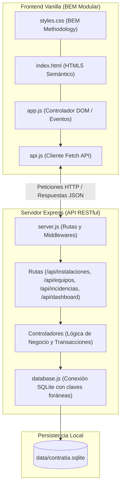
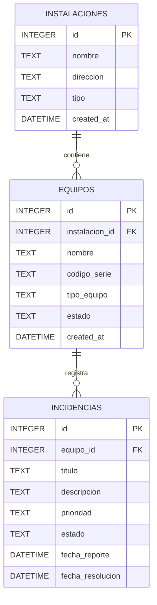

# Contratia Mini - Sistema de Gestión de Instalaciones, Equipos e Incidencias

[](https://nodejs.org/)
[](https://expressjs.com/)
[](https://sqlite.org/)
[](https://en.bem.info/)
[](https://jestjs.io/)

Aplicación web integral desarrollada para la gestión del mantenimiento técnico de infraestructuras: registro y categorización de **instalaciones**, catalogación de sus **equipos técnicos** y seguimiento ágil de **averías o incidencias**.

> **Ejemplo de Caso de Uso Real:**  
> En una instalación pública (*"Biblioteca Pública Central"*), el ascensor principal (*"Ascensor Principal - Bloque A"*, código `ASC-LIB-001`) sufre un bloqueo de tracción entre plantas. El equipo técnico registra una incidencia con prioridad `CRITICA`, lo que conmuta automáticamente el estado del ascensor a `AVERIADO`. Tras la intervención, al marcar la avería como `RESUELTA`, el sistema sella la marca de tiempo de cierre y devuelve de forma automática el equipo a estado `OPERATIVO`.

---

## 1. Tecnologías Empleadas

* **Backend:** Node.js (v24+) con Express.js.
* **Base de Datos:** SQLite nativo (`node:sqlite`) con claves foráneas estrictas (`PRAGMA foreign_keys = ON;`) y transacciones atómicas.
* **Frontend:** HTML5 semántico y accesible, CSS3 estructurado bajo la metodología **BEM (Bloque__Elemento--Modificador)** y JavaScript Vanilla (ES6+, Fetch API, sin frameworks cliente).
* **Testing Automatizado:** **Jest** y **Supertest** para pruebas de integración de endpoints, reglas de negocio y borrado en cascada.
* **Asistencia Inteligente:** Skills personalizadas para Antigravity (`api-rest` e `interfaces-crud`).

---

## 2. Arquitectura del Sistema

El proyecto implementa una **Arquitectura en Capas Desacoplada**:



---

## 3. Modelo de Datos Relacional (3 Tablas)



---

## 4. Instalación y Puesta en Marcha

### Prerrequisitos
* Node.js v24.0.0 o superior instalado.
* npm (incluido con Node.js).

### Pasos de ejecución:

1. **Instalar dependencias:**
   ```bash
   npm install
   ```

2. **Inicializar y poblar la Base de Datos:**
   Ejecuta el script de creación del esquema DDL y carga de datos de prueba realistas:
   ```bash
   npm run init-db
   ```

3. **Ejecutar la suite de pruebas automatizadas (Jest + Supertest):**
   ```bash
   npm test
   ```
   *Ejecuta 20 pruebas de integración que validan códigos HTTP, integridad referencial, unicidad y transiciones automáticas de estado.*

4. **Arrancar el servidor de la aplicación:**
   ```bash
   npm start
   ```
   La aplicación estará accesible en tu navegador web en:
   👉 **http://localhost:3000**

---

## 5. Endpoints de la API REST

Todas las respuestas de la API siguen el envoltorio JSON estándar:
`{ "success": true, "data": ... }` o `{ "success": false, "error": "..." }`.

| Método | Endpoint | Descripción | Códigos HTTP |
| :--- | :--- | :--- | :--- |
| **GET** | `/api/health` | Comprobación de estado del servicio | `200` |
| **GET** | `/api/dashboard/stats` | Métricas y resumen global para el panel de control | `200` |
| **GET** | `/api/instalaciones` | Listado general con contadores de equipos y averías | `200` |
| **GET** | `/api/instalaciones/:id` | Detalle de una instalación con sus equipos asociados | `200`, `404` |
| **POST** | `/api/instalaciones` | Alta de nueva instalación | `201`, `400` |
| **PUT** | `/api/instalaciones/:id` | Modificación de datos de una instalación | `200`, `400`, `404` |
| **DELETE** | `/api/instalaciones/:id` | Eliminación (en cascada hacia equipos e incidencias) | `200`, `404` |
| **GET** | `/api/equipos` | Listado de equipos (filtros: `instalacion_id`, `estado`) | `200` |
| **GET** | `/api/equipos/:id` | Detalle de un equipo con su historial de incidencias | `200`, `404` |
| **POST** | `/api/equipos` | Registro de equipo técnico (valida código único) | `201`, `400`, `409` |
| **PUT** | `/api/equipos/:id` | Modificación de datos o estado operativo | `200`, `400`, `404`, `409` |
| **DELETE** | `/api/equipos/:id` | Eliminación de equipo e historial de averías | `200`, `404` |
| **GET** | `/api/incidencias` | Listado de incidencias (filtros: `estado`, `prioridad`) | `200` |
| **GET** | `/api/incidencias/:id` | Detalle de la incidencia y equipo afectado | `200`, `404` |
| **POST** | `/api/incidencias` | Reporte de incidencia (avería crítica pasa equipo a `AVERIADO`) | `201`, `400` |
| **PUT** | `/api/incidencias/:id` | Actualización o resolución (restaura equipo a `OPERATIVO`) | `200`, `400`, `404` |
| **DELETE** | `/api/incidencias/:id` | Eliminación de registro de avería | `200`, `404` |

---

## 6. Skills Personalizadas para Antigravity (Requisito 2)

El proyecto cuenta con dos Skills de desarrollo reutilizables ubicadas en `.agents/skills/`:

1. **`api-rest`** ([.agents/skills/api-rest/SKILL.md](.agents/skills/api-rest/SKILL.md)):
   * Pautas de diseño RESTful, verbos y códigos HTTP estándar.
   * Sentencias preparadas SQLite obligatorias para prevención de inyección SQL.
   * Manejo de transacciones atómicas para sincronización de estados.
   * Middleware centralizado de errores y rutas 404.

2. **`interfaces-crud`** ([.agents/skills/interfaces-crud/SKILL.md](.agents/skills/interfaces-crud/SKILL.md)):
   * Estructura semántica HTML5 y accesibilidad (roles ARIA, labels vinculados).
   * Arquitectura CSS modular basada en **BEM (Bloque__Elemento--Modificador)** con variables para estados operativos.
   * Patrón Fetch nativo con `async/await`, control de botones y notificaciones flotantes (Toasts).
   * Modales unificados para alta/edición y confirmación de borrados críticos.

Las evidencias y justificación técnica para la evaluación docente se encuentran detalladas en [docs/EVIDENCIAS_SKILLS.md](docs/EVIDENCIAS_SKILLS.md).

---

## 7. Matriz de Cumplimiento de Criterios de Aceptación

| Criterio | Descripción | Estado de Verificación |
| :--- | :--- | :--- |
| **CA-01** | Integridad referencial (`PRAGMA foreign_keys = ON;`), unicidad de serie (`UNIQUE`) y borrado en cascada. | ✅ **Verificado:** Superadas pruebas unitarias y en cascada en Jest. |
| **CA-02** | API RESTful con respuestas JSON estandarizadas y códigos HTTP apropiados (`200`, `201`, `400`, `404`, `409`). | ✅ **Verificado:** 20 pruebas de integración automatizadas con Supertest. |
| **CA-03** | Frontend Vanilla interactivo sin frameworks, validación en cliente/servidor y feedback visual no intrusivo. | ✅ **Verificado:** HTML5 accesible, CSS con BEM y Vanilla JS funcional. |
| **CA-04** | Lógica de negocio de averías (conmutación automática `OPERATIVO` ↔ `AVERIADO` y registro de resolución). | ✅ **Verificado:** Comprobado mediante transacción en Jest y en la interfaz. |
